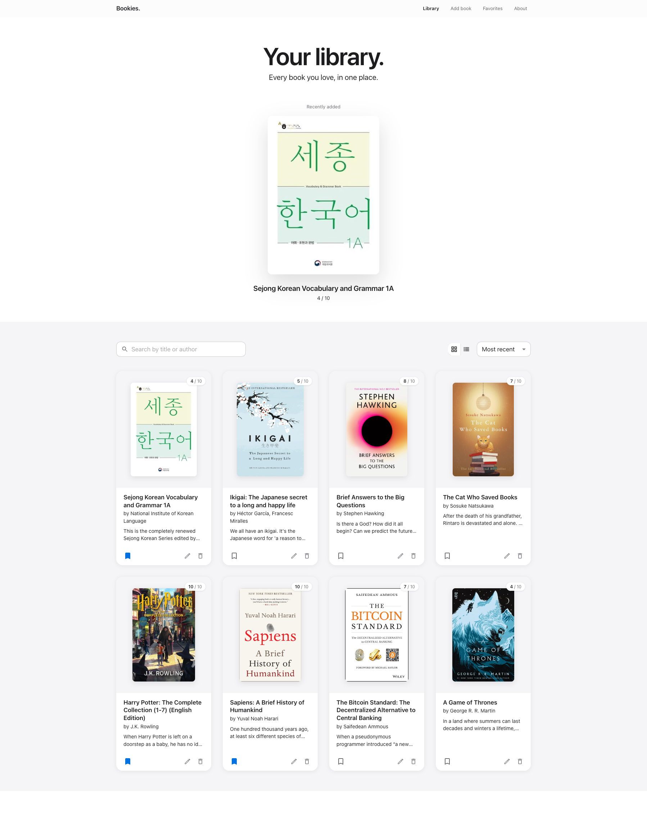

# Bookies

A personal library app built on the MERN stack — track the books you read, rate them from 1 to 10, and bookmark the keepers.



## Features

- **Library** — browse your collection with search by title or author, sorting (most recent, top rated, earliest), and a grid/list view toggle
- **Featured book** — the newest addition is showcased on the home page as a large cover shot
- **Live cover preview** — the add-book form renders the cover, title, author, and rating as you type
- **Star ratings** — tap 1–10 stars with a live numeric readout
- **Bookmarks** — save favorites; the Favorites page shows your best-loved books in a fanned cover collage plus a cover gallery
- **Book details** — a product-page style dialog with cover, specs, description, and actions
- **Polish** — delete confirmations, loading skeletons, and empty states throughout

## Tech stack

| Layer | Tools |
| --- | --- |
| Database | MongoDB with Mongoose |
| Server | Express 5 (ESM), CORS, dotenv |
| Client | React 19, Vite, MUI 9, React Router 7, axios, Sass |

## Getting started

Prerequisites: Node.js and a MongoDB instance (local or Atlas).

**1. Start the server**

```sh
cd server
cp .env.example .env   # then edit DB_URI; APP_PORT defaults to 4000
npm install
npm run dev            # nodemon — http://localhost:4000
```

**2. Start the client**

```sh
cd client
npm install
npm run dev            # vite — http://localhost:3000
```

## API

Base URL: `http://localhost:4000/books`

| Method | Endpoint | Description |
| --- | --- | --- |
| GET | `/books` | List all books |
| GET | `/books/:id` | Get one book |
| POST | `/books` | Add a book (duplicate titles return 409) |
| PATCH | `/books/:id` | Update a book |
| PATCH | `/books/:id/favorite` | Toggle the bookmark flag |
| DELETE | `/books/:id` | Delete a book |

## Project structure

```
server/
  index.js               # entry: env config, Express app, Mongo connection
  models/book.js         # title, description (≤1000), author, rating (1–10), pages, imageUrl
  controllers/books.js   # CRUD + duplicate-title check + favorite toggle
  routers/books.js       # route definitions

client/
  src/App.jsx            # routes nested under the AppShell layout
  src/theme.js           # design tokens (colors, typography, component overrides)
  src/components/        # AppShell, PageHeader, dialogs
  src/components/books/  # BookCard, BookRow, GalleryCard, BookDetailForm, etc.
  src/pages/             # Home, NewBook, EditBook, Favorites, About
  src/context/           # books reducer
  src/helper.js          # axios wrappers
```

## Design notes

The UI follows an Apple-inspired system: the system font stack (SF Pro on macOS), a white and `#f5f5f7` palette with `#1d1d1f` text and a single `#0071e3` blue accent, pill buttons, 18px rounded cards, and cover-led layouts where book covers are the hero imagery. All tokens live in `client/src/theme.js`.
